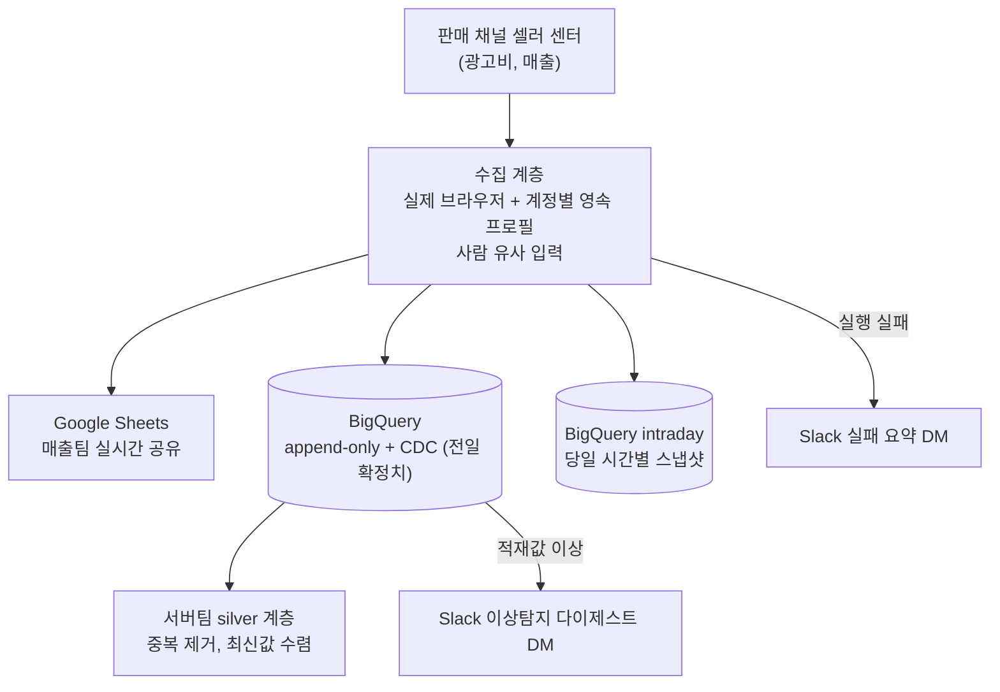

# 커머스 채널 데이터 수집 자동화 파이프라인

> 13개 브랜드의 광고비와 매출을 쿠팡 계정 11개와 네이버에서 자동으로 수집하고, 적재 전 여러 겹의 검증 게이트를 거쳐 BigQuery에 쌓는 일간 배치와 시간별 배치를 설계하고 운영하는 데이터 파이프라인. 모니터링과 장애 대응까지 포함한다.

- **참여도**: 100%, 파이프라인 설계와 개발 (크롤러 / API 연동 / 적재 / 정합성 검증)

## 문제

담당자가 판매 채널의 광고센터와 판매자센터를 매일 직접 들여다보며 브랜드별 매출과 광고비를 수기 집계했다. 채널 한 곳은 공식 API가 이미 주문 관리 솔루션(사방넷)에 연결돼 있어 같은 계정으로 추가 연동이 불가했고, 강한 봇 차단과 수시로 바뀌는 프론트 UI를 갖고 있어, 단순 스크립트로는 금방 막히거나 깨진다. 이 파이프라인은 **"차단을 넘고, UI 변화를 견디고, 틀린 값이 조용히 들어가는 걸 잡는"** 데 초점이 맞춰져 있다.

## 시스템 아키텍처

자세한 구조는 [docs/architecture.md](./docs/architecture.md) 참고.

## 주요 기능

- **채널별 수집 전략 분리**: API 연동이 이미 점유된 채널은 운영 중인 연동을 유지한 채 실제 브라우저 기반 수집, 공식 API를 쓸 수 있는 채널(정산)은 직접 연동
- **다중 적재**: 매출팀용 Sheets / 누적 분석용 BigQuery(전일 확정) / 당일 시간별 스냅샷 세 경로 분기
- **거짓 성공 방지**: 빈 표, 오래된 값, 우연히 맞는 합계 등 "성공처럼 보이는 실패"를 다층 검증으로 차단
- **두 층의 Slack 알림**: 실행 실패 요약과 적재값 이상 다이제스트를 분리 운영
- **적재 전 검증 게이트**: 화면 요약 카드 대조, 성과 그래프와 원 단위 대조, 예산 배수 가드, 전날 집계 생성 확인, 페이지 누락 검사, 같은 이름 캠페인 분리. 하나라도 어긋나면 적재하지 않는다
- **늦게 확정되는 값 반영**: 광고 전환 매출은 며칠 뒤에야 확정되므로 매일 최근 7일치를 다시 넣어 어제의 잠정값이 나중에 확정값으로 바뀌게 한다
- **아침 자동 Slack 리포트**: 전날 수집 결과를 매일 아침 Slack으로 자동 보고
- **운영 장애 대응**: 팝업이 버튼을 가리거나, 화면이 다른 곳으로 넘어가거나, 크롬 업데이트로 로그인 쿠키가 지워지는 문제를 원인별로 찾아 고친 이력이 [troubleshooting.md](./docs/troubleshooting.md)에 있다

자세한 설명은 [docs/main-features.md](./docs/main-features.md) 참고.

## 맡은 역할

- 봇 차단과 UI 드리프트에 견디는 수집 계층 설계와 구현
- BigQuery append-only + CDC 적재 구조 및 최소 권한 서비스 계정 설계
- 정합성 검증(거짓 성공 방지)과 이상탐지 다이제스트 구현
- 운영 배포 체계(git 기반, Windows 작업 스케줄러) 구축

## 운영 규모

| 항목 | 값 |
|---|---|
| 운영 기간 | 2026년 7월부터 현재 |
| 수집 대상 | 쿠팡 계정 11개, 브랜드 13개 |
| 데이터 유형 | 매출성장, 신규구매, 인지도 세 가지 광고 목적의 성과 |
| 배치 | 새벽 일간 통합 배치 1회, 당일 스냅샷 시간별 배치 |
| 가공 경계 | 검증된 원천 데이터까지 이 파이프라인이 만들고, 그 위의 가공 테이블과 아침 재생성은 서버팀이 맡는다 |

## 성과

- **수기 집계 대비 일 2~3시간 절감** (13개 브랜드 자동 수집)
- 적재 전 교차검증으로 "성공처럼 보이는 실패"를 차단하고, 매일 아침 Slack 리포트로 상태 확인에 드는 시간을 없앰

## 문서

| 문서 | 내용 |
|---|---|
| [architecture.md](./docs/architecture.md) | 수집, 적재, 모니터링 계층 구조 |
| [tech-stack.md](./docs/tech-stack.md) | 실브라우저, BigQuery CDC, 최소 권한 등 선택 이유 |
| [main-features.md](./docs/main-features.md) | 주요 기능 상세 |
| [troubleshooting.md](./docs/troubleshooting.md) | 봇 차단, 셀렉터 드리프트, 데이터 정합성 사례 |
